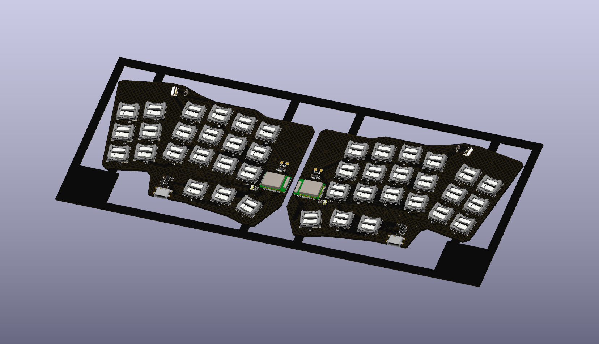
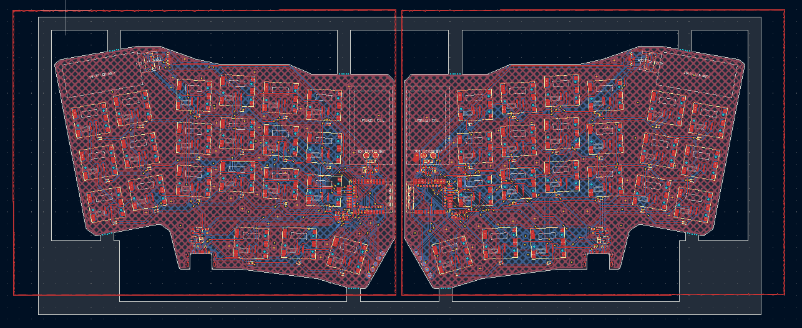
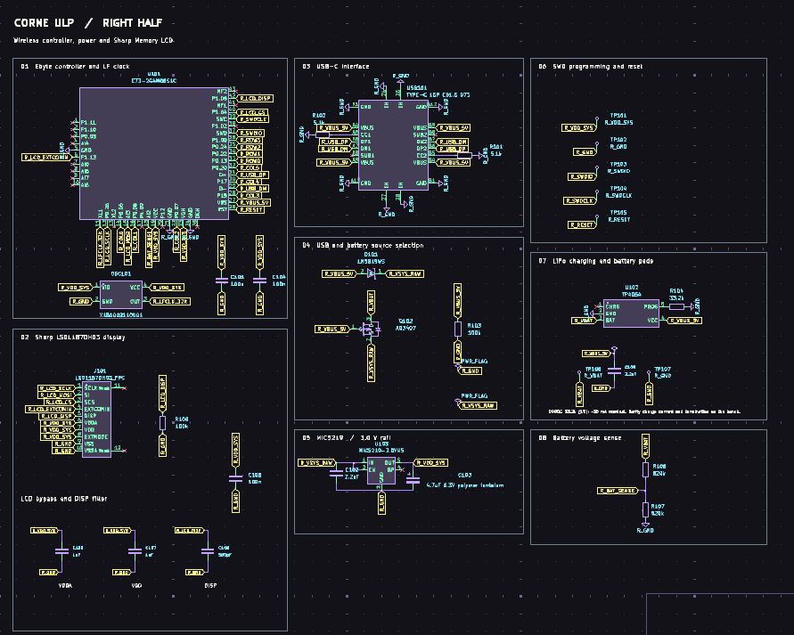
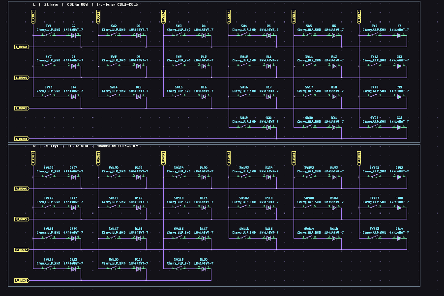
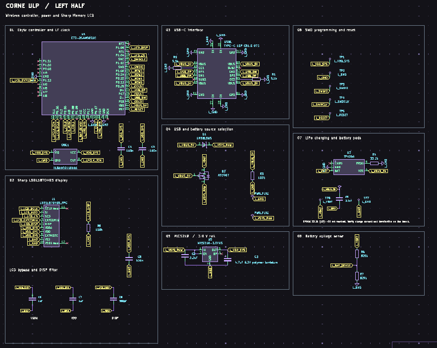

# AERIX-ULP

AERIX-ULP is a low-profile split mechanical keyboard with a custom layout.
It is designed around Cherry MX Ultra Low Profile switches and uses a separate
wireless controller and battery-powered electronics on each half.

The board includes:

- 42 keys with per-key diodes
- Wireless nRF52 modules
- USB-C charging and programming
- Separate Li-Po battery support for each half
- 3.0 V regulation
- LCD connectors
- SWD programming and test points
- No 3D-printed case; the underside uses rubber grip dots



AERIX-ULP is a custom keyboard design rather than a Corne-layout derivative.
This project includes the schematics, PCB layout, component library, and
schematics, PCB layout, component library, and production files.

## Board views






- [Main schematic source](hardware/split/split.kicad_sch)
- [Left-half schematic source](hardware/split/left.kicad_sch)
- [Right-half schematic source](hardware/split/right.kicad_sch)
- [Switch matrix schematic source](hardware/split/switch.kicad_sch)
- [PCB layout source](hardware/split/split.kicad_pcb)

schematics and layout.

## Hardware Development

1. Open the KiCad project in `hardware/split/`.
2. Review the custom-layout schematics and PCB layout.
3. Continue placement, routing, and electrical validation in KiCad.
4. Generate fabrication files when the hardware design is ready.
5. Use the production BOM and placement files for assembly.

## Assembly and first power-up

1. Assemble one half and check component orientation.
2. Inspect for solder bridges and shorts.
3. Power it from USB with the battery disconnected.
4. Check `VDD_SYS` and the 3.0 V rail.
5. Connect the battery after the rail check passes.
6. Flash ZMK over SWD and test every key.
7. Repeat for the other half, then test pairing and the inter-half connection.

### Firmware flashing over SWD

Use a 3.3 V-compatible J-Link or CMSIS-DAP probe.

1. Connect `VTref`, `GND`, `SWDIO`, `SWCLK`, and `nRESET` to the matching
   `VDD_SYS`, `GND`, `SWDIO`, `SWDCLK`, and `RESET` test points.
2. Build ZMK and place the generated `firmware.hex` beside `nrfjprog`.
3. Power the half and run:

   ```text
   nrfjprog --program firmware.hex --verify --reset
   ```

Repeat for the other half.


## Source Files

- **Main schematic:** `hardware/split/split.kicad_sch`
- **Left-side schematic:** `hardware/split/left.kicad_sch`
- **Right-side schematic:** `hardware/split/right.kicad_sch`
- **Switch schematic:** `hardware/split/switch.kicad_sch`
- **PCB layout:** `hardware/split/split.kicad_pcb`
- **KiCad project:** `hardware/split/split.kicad_pro`
- **Custom symbols and footprints:** `lib/`
- **ZMK firmware:** `firmware/`

## Production Bill of Materials

The production BOM is available here: [production/bom.csv](production/bom.csv).
The placement files are also available in the [`production/`](production/)
folder:

- [designators.csv](production/designators.csv)
- [positions.csv](production/positions.csv)

The BOM contains **33 line items** and **146 individual parts** for one
complete board assembly. It includes both keyboard halves.

| Designator | Footprint | Qty | Value | LCSC Part # / sourcing |
|---|---|---:|---|---|
| C1, C101, C104, C105, C4, C5 | 0603 | 6 | 100n | [LCSC search](https://www.lcsc.com/search?q=0603%20100nF) |
| C102, C109, C2, C9 | 0603 | 4 | 2.2uF | [LCSC search](https://www.lcsc.com/search?q=0603%202.2uF) |
| C103, C3 | CAP-SMD_L1.6-W0.8-RD | 2 | 4.7uF 6.3V polymer tantalum | [C2158419](https://www.lcsc.com/product-detail/C2158419.html) |
| C106, C107, C6, C7 | 0402 | 4 | 1uF | [LCSC search](https://www.lcsc.com/search?q=0402%201uF) |
| C108, C8 | 0402 | 2 | 560pF | [LCSC search](https://www.lcsc.com/search?q=0402%20560pF) |
| D1, D101 | SOD-323_L1.7-W1.3-LS2.7-RD | 2 | 1N5819WS | [C489147](https://www.lcsc.com/product-detail/C489147.html) |
| D2-D22, D102-D122 | SOD-523_L1.2-W0.8-LS1.6-RD | 42 | 1N4148WT-7 | [C83482](https://www.lcsc.com/product-detail/C83482.html) |
| J1, J101 | FFC-SMD_10P-P0.50_FH34SRJ-10S-0.5SH | 2 | LS011B7DH03_FPC | [C324723](https://www.lcsc.com/product-detail/C324723.html) |
| OSC1, OSC101 | OSC-SMD_4P-L3.2-W1.5 | 2 | X1B0002110001 | [C256005](https://www.lcsc.com/product-detail/C256005.html) |
| Q2, Q102 | SOT-23-3_L3.0-W1.7-P0.95-LS2.9-BR | 2 | AO3407 | [C351408](https://www.lcsc.com/product-detail/C351408.html) |
| R1, R101, R102, R2 | 0402 | 4 | 5.1k | [LCSC search](https://www.lcsc.com/search?q=0402%205.1k) |
| R3, R8, R103, R108 | 0402 | 4 | 100k | [LCSC search](https://www.lcsc.com/search?q=0402%20100k) |
| R4, R104 | 0402 | 2 | 33.2k | [LCSC search](https://www.lcsc.com/search?q=0402%2033.2k) |
| R6, R7, R106, R107 | 0402 | 4 | 820k | [LCSC search](https://www.lcsc.com/search?q=0402%20820k) |
| SW1-SW21, SW101-SW121 | Cherry_ULP_SMD | 42 | Cherry_ULP_SMD | [Cherry MX ULP](https://www.cherry.de/en-us/products/switches/mx-ultra-low-profile) |
| TP1 | TestPoint_Pad_D1.5mm | 1 | L_VDD_SYS | [LCSC search](https://www.lcsc.com/search?q=1.5mm%20test%20point%20pad) |
| TP2, TP7 | TestPoint_Pad_D1.5mm | 2 | L_GND | [LCSC search](https://www.lcsc.com/search?q=1.5mm%20test%20point%20pad) |
| TP3 | TestPoint_Pad_D1.5mm | 1 | L_SWDIO | [LCSC search](https://www.lcsc.com/search?q=1.5mm%20test%20point%20pad) |
| TP4 | TestPoint_Pad_D1.5mm | 1 | L_SWDCLK | [LCSC search](https://www.lcsc.com/search?q=1.5mm%20test%20point%20pad) |
| TP5 | TestPoint_Pad_D1.5mm | 1 | L_RESET | [LCSC search](https://www.lcsc.com/search?q=1.5mm%20test%20point%20pad) |
| TP6 | TestPoint_Pad_D2.0mm | 1 | L_VBAT | [LCSC search](https://www.lcsc.com/search?q=2mm%20test%20point%20pad) |
| TP101 | TestPoint_Pad_D1.5mm | 1 | R_VDD_SYS | [LCSC search](https://www.lcsc.com/search?q=1.5mm%20test%20point%20pad) |
| TP102, TP107 | TestPoint_Pad_D1.5mm | 2 | R_GND | [LCSC search](https://www.lcsc.com/search?q=1.5mm%20test%20point%20pad) |
| TP103 | TestPoint_Pad_D1.5mm | 1 | R_SWDIO | [LCSC search](https://www.lcsc.com/search?q=1.5mm%20test%20point%20pad) |
| TP104 | TestPoint_Pad_D1.5mm | 1 | R_SWDCLK | [LCSC search](https://www.lcsc.com/search?q=1.5mm%20test%20point%20pad) |
| TP105 | TestPoint_Pad_D1.5mm | 1 | R_RESET | [LCSC search](https://www.lcsc.com/search?q=1.5mm%20test%20point%20pad) |
| TP106 | TestPoint_Pad_D2.0mm | 1 | R_VBAT | [LCSC search](https://www.lcsc.com/search?q=2mm%20test%20point%20pad) |
| U1, U101 | WIRELM-SMD_E73-2G4M08S1C | 2 | E73-2G4M08S1C | [C356849](https://www.lcsc.com/product-detail/C356849.html) |
| U2, U102 | SOT-23-5_L3.0-W1.7-P0.95-LS2.8-BL | 2 | TP4054 | [C32574](https://www.lcsc.com/product-detail/C32574.html) |
| U3, U103 | SOT-23-5 | 2 | MIC5219-3.0YM5 | [LCSC search](https://www.lcsc.com/search?q=MIC5219-3.0YM5) |
| USB1, USB101 | USB-C-SMD_SHOU_TYPE-C-16P-CB1.6 | 2 | TYPE-C 16P CB1.6 073 | [C2906290](https://www.lcsc.com/product-detail/C2906290.html) |
